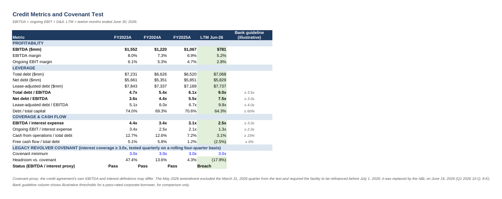
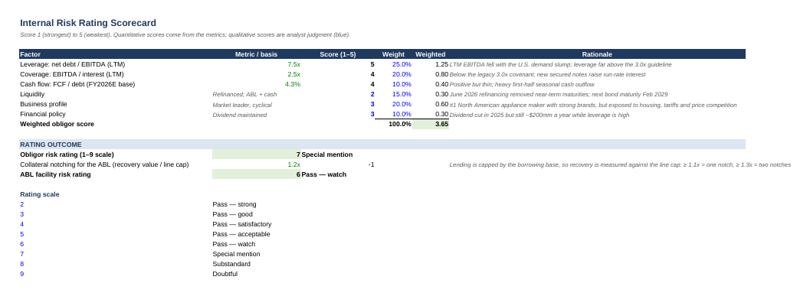

# Whirlpool Corporation — Credit Analysis & Credit Memo

A commercial-bank style credit analysis of **Whirlpool Corporation (NYSE: WHR)**, built from its SEC filings and current bond market data. The question it answers: **should a bank take a $150 million participation in Whirlpool's new $2.0 billion senior secured asset-based loan (ABL)?**

- [`Whirlpool_Credit_Memo.pdf`](Whirlpool_Credit_Memo.pdf) — four-page credit memo with the recommendation, analysis, risks and conditions
- [`Whirlpool_Credit_Analysis.xlsx`](Whirlpool_Credit_Analysis.xlsx) — the supporting Excel model, with every figure linked to its source

*Portfolio exercise prepared from public information; not an actual lending decision or investment advice.*

## Recommendation

**Approve the secured ABL participation with conditions. Decline unsecured exposure.**

| | Rating | Why |
|---|---|---|
| Obligor (Whirlpool) | **7 — Special mention** | Net debt / EBITDA 7.5x; EBITDA / interest 2.5x, below the old 3.0x covenant |
| ABL facility | **6 — Pass / watch** | First lien; lending capped by a borrowing base covered ~1.2x by collateral recovery value |

## Key findings

- **The credit has deteriorated fast.** EBITDA fell from $1,552mm (FY2023) to $781mm (LTM June 2026), and leverage doubled. Ongoing EBIT margins were 1.3% in Q1 2026 and 1.8% in Q2 2026 as U.S. appliance demand dropped.
- **A covenant problem forced a refinancing.** Interest coverage fell from 4.4x to 2.5x, below the 3.0x revolver minimum. The bank group excluded the Q1 2026 test and required a refinancing. Whirlpool replaced the revolver on June 16, 2026 with a $2.0B ABL and $2.0B of second-lien notes at 7.50% and 7.875%.
- **The refinancing is expensive.** Run-rate interest rises to about $418mm, which cuts coverage to about 1.9x on LTM EBITDA. Unsecured bonds trade at 76–92 cents (8.6–11.8% yields), and all three agencies rate the company BB or Ba3.
- **The ABL is still well protected.** It lends only against eligible receivables, inventory and equipment, estimated at about $1.45B, and ranks ahead of $2.0B of second-lien notes and the unsecured bonds.
- **Base case vs. stress case.** On management's guidance, net leverage falls to 4.6x by FY2028. In a prolonged downturn it stays near 8x, and the company needs about $600mm of extra borrowing. Fixed charge coverage is below 1.0x in both cases in at least one year, so the recommended conditions focus on minimum availability and blocking the dividend.

## What's in the model

| Sheet | What it does |
|---|---|
| Cover | Request, recommendation, ratings and key metrics (live) |
| Financials | Reported spreads FY2023–FY2025, H1 2025/2026 and LTM June 2026 |
| Credit Metrics | Leverage, coverage, cash flow ratios and the legacy 3.0x covenant test with headroom |
| Capital Structure | Pro forma debt stack after the refinancing, interest run-rate, bond prices and yields, rating history |
| Projections | Base and stress cases for FY2026–FY2028: EBITDA, free cash flow, net debt, leverage, coverage and the ABL springing FCCR test |
| ABL Collateral | Borrowing base estimate with eligibility, liquidation values and advance rates; springing covenant trigger |
| Risk Rating | Weighted scorecard → obligor rating, with collateral notching to the facility rating |
| Sources | Every filing and data page used |

## Method notes

- **EBITDA** = Whirlpool's ongoing EBIT + D&A. **LTM** = FY2025 − H1 2025 + H1 2026.
- **Covenant test:** the interest coverage check is a proxy, since the credit agreement's exact definitions are not public.
- **Borrowing base:** the advance rates, liquidation values and the 65% U.S. & Canada asset share are assumptions. Intellectual property is excluded to stay conservative.
- **Pro forma debt:** "other debt" is the residual to reported total debt, at an assumed 5.25% blended rate.

## Sources

Whirlpool earnings releases for Q4 2024, Q4 2025, Q1 2026 and Q2 2026; the Q1 2026 Form 10-Q; the FY2025 Form 10-K; the June 2026 8-K on the secured notes and ABL; and bond prices and ratings from BondTerminal (October 2026). Full links are on the Sources sheet and at the end of the memo.

*Tools: Excel (credit spreads, ratio analysis, scenario projections, borrowing base, risk rating scorecard), Word.*
